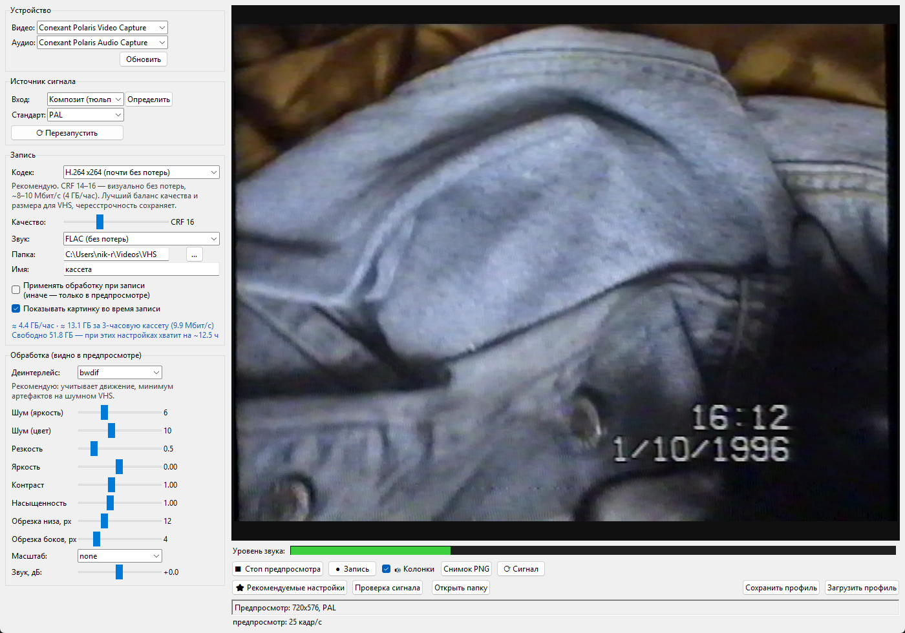

# VHS Studio — замена Rombica Pro Studio (EZ Grabber)

Программа для оцифровки VHS через Rombica Pro Studio (чип Conexant Polaris).
Захватывает видео и звук, показывает живой предпросмотр с обработкой,
пишет современными кодеками и запоминает настройки под каждую кассету.



---

## Запуск

1. Воткнуть Rombica в USB, подключить магнитофон (тюльпаны: жёлтый — видео,
   белый/красный — звук).
2. Двойной клик по **`VHS Studio.bat`**. Предпросмотр включается сам.
3. Размер предпросмотра подстраивается под окно автоматически (до 1100 по
   ширине — дальше смысла нет, исходник всё равно 720×576). Разверните окно
   на весь экран — картинка станет крупной. Внизу справа видно реальную
   частоту кадров: должно быть ~25 кадр/с. Если меньше — уменьшите окно.
4. Если картинки нет или она чёрная — нажать **«⟳ Перезапустить»**
   (у этого чипа бывает «залипание»: чёрный экран, пока не передёрнешь стандарт).
5. Крутить ползунки, глядя на картинку. **«🔊 Колонки»** включает и выключает
   звук в колонках (в файл звук пишется всегда).
6. **«● Запись»** → по окончании **«■ Стоп записи»** (файл дописывается
   и закрывается примерно за секунду).

Звук с кассеты по умолчанию идёт в колонки. Не нужен — нажмите
**«🔊 Колонки»**: запись при этом продолжит идти со звуком. Прослушивание
работает через `ffplay` (лежит рядом с ffmpeg).

Все настройки запоминаются между запусками: в следующий раз всё будет как
в прошлый. Профили нужны, чтобы хранить несколько разных наборов сразу.

**Требуется:** Python 3.11+ с Pillow и `ffmpeg` в PATH
(проверено на Python 3.14 + ffmpeg 8.1 + Pillow 12.1).
`ffplay` нужен только для прослушивания в колонках — он идёт в комплекте
с ffmpeg.

Запуск из консоли:

```bash
pip install pillow
python -m vhs_studio
```

---

## Что важно знать про это железо

Всё ниже проверено на живом устройстве, а не взято из инструкции.

| Факт | Следствие |
|---|---|
| Чип отдаёт максимум **720×576 @ 25 fps** (PAL) или **720×480 @ 29.97** (NTSC), 4:2:2 | Больше из Rombica не выжать. Это ровно то, что нужно VHS |
| Формат **YUYV сломан** — картинка зелёная | Программа всегда просит **UYVY**. В OBS/других программах выбирайте UYVY |
| Композит сидит на **пине 1** кроссбара, S-Video — на пине 0 | Кнопка «Определить» находит нужный вход сама |
| Звук идёт **только вместе с видео** (отдельно — цифровой нуль) | Галочка «Писать звук» + видео всегда включены вместе |
| Звук всегда **48 кГц, 16 бит, стерео** | Пересэмплировать не нужно, рассинхрона нет |
| Кадры **чересстрочные, верхнее поле первое (TFF)** | Деинтерлейс обязателен для просмотра на ПК |
| Внизу кадра **~12–20 строк мусора** (head switching) | Ползунок «Обрезка низа» |
| Пропуски кадров | ~0.3 % на 40 с. Лечится `rtbufsize` (уже включено) |
| Бывает **чёрный экран до смены стандарта** | Кнопка «⟳ Перезапустить»; программа делает это сама, но только если кадров нет 8 секунд, и не более одного раза подряд |
| **SECAM** | Чип гонит его в той же развёртке 625/50, что и PAL — поэтому в списке стандартов он есть, но размеры те же 720×576 |

---

## Рекомендуемые настройки для этого ПК

Замерено на i5-11400F / 32 ГБ / RTX 3060 Ti, кассета 720×576, без деинтерлейса:

| Кодек | Битрейт | Скорость | Комментарий |
|---|---|---|---|
| **x264 CRF 16** | 11.1 Мбит/с | **8.2×** | лучший выбор: сохраняет чересстрочность, огромный запас по скорости |
| x265 CRF 20 | 4.5 Мбит/с | 1.3× | впритык к реальному времени — риск пропусков кадров |
| HEVC NVENC CQ 22 | 2.9 Мбит/с | 11.4× | быстро и компактно, но **не сохраняет чересстрочность** |
| AV1 SVT CRF 26 | 2.6 Мбит/с | 5.4× | самый маленький файл, процессор занят |
| FFV1 | 66.8 Мбит/с | 8.3× | архив без потерь, 27 ГБ/час |

**Ставьте так:**

- Кодек — **H.264 x264**, CRF **16**.
- Деинтерлейс — **bwdif**.
- «Применять обработку при записи» — **выключено** (пишем чистое сырьё).
- Шум: яркость **6**, цвет **10**, резкость **0.5**.
- Обрезка низа **12**, боков **4**.

Одной кнопкой: **«⭐ Рекомендуемые настройки»** в нижнем ряду.

### Нужно ли писать через GPU?

Замер на реальной кассете (20 с, цепочка bwdif + шумодав, VMAF относительно
обработанного эталона):

| Кодек | Битрейт | VMAF |
|---|---|---|
| x264 CRF 16 | 5.58 Мбит/с | 93.4 |
| x264 CRF 20 | 3.07 Мбит/с | 90.0 |
| NVENC CQ 18 | 3.91 Мбит/с | **93.5** |
| NVENC CQ 22 | 2.34 Мбит/с | 91.0 |
| NVENC CQ 26 | 1.35 Мбит/с | 87.9 |

Вывод неочевидный: **по эффективности NVENC на Ampere не хуже** — то же
качество (93.5 против 93.4) при битрейте на 30 % меньше. Причина в том, что
он мягче обращается с зерном, а на VHS зерно — это шум, который метрика
штрафует.

Поэтому единственный настоящий минус NVENC — **чересстрочность**:

- он её не сохраняет, деинтерлейс придётся запекать навсегда;
- если деинтерлейс не включён, на движении будет «гребёнка» (программа
  предупредит красной строкой).

Когда брать GPU: нужен небольшой файл сразу, процессор занят, или идёт поток
кассет. Когда не брать: если кассета ценная и вы хотите сохранить сырьё,
чтобы потом обработать его нормальным деинтерлейсером (QTGMC).

При любом выборе GPU включайте «Применять обработку при записи».

Для максимального качества деинтерлейса есть QTGMC (VapourSynth) — он заметно
лучше любого фильтра ffmpeg, но требует отдельной установки и считается медленно.
Это уже пост-обработка готового файла, не захват.

## Автостоп и перемотка

**«Останавливать запись, если нет N мин звука и картинки»** (по умолчанию 15).
Работает по схеме «И», а не «ИЛИ»: запись прекращается, только когда
одновременно нет и звука, и картинки. Поэтому повреждённые участки кассеты,
где пропало изображение, но звук остался, пишутся до конца. Удобно ставить
на ночь длинную кассету: когда она закончится, запись встанет сама.

Дозаписи на кассете автостоп не обрывает — 15 минут тишины подряд в фильме
не встречаются, а если и встретятся, галочку можно снять.

**Перемотка.** Проверено замерами: во время FFWD/REW чип Conexant Polaris
практически **перестаёт отдавать кадры** — 0–2 кадра за 10 секунд вместо 250.
Никакой софт этого не исправит: комплектная программа Rombica показывает
в этот момент ровно такую же замершую картинку. Что делает наша программа:

- в статусе появляется «Нет кадров N с — вероятно, идёт перемотка»;
- галочка **«⏩ Поиск»** переключает предпросмотр на облегчённую цепочку
  (без шумодава, деинтерлейса и резкости) — когда кадры всё-таки приходят,
  картинка обновляется быстрее;
- в режиме поиска автоматическая переинициализация не срабатывает, чтобы
  не дёргать устройство зря;
- после остановки перемотки картинка возвращается за ~1 секунду. Если
  застряла на синем экране — кнопка **«⟳ Перезапустить»**.

Практический способ искать место на кассете: перемотка → короткое Play →
смотрите картинку → снова перемотка. Либо по счётчику магнитофона.

## Настройки записи

**Кодек**

| Вариант | Когда | Размер |
|---|---|---|
| FFV1 | архив «как есть», без потерь | ~30 ГБ/час |
| H.264 x264, CRF 14–16 | **рекомендую по умолчанию** — визуально без потерь | ~8 ГБ/час |
| H.265 x265 / NVENC | если места мало, разница на глаз минимальна | ~2–3 ГБ/час |
| AV1 SVT | максимальное сжатие, кодирует медленно | ~2 ГБ/час |
| MPEG-2 | только если нужен DVD-плеер | ~4 ГБ/час |

**Качество (CRF)**: меньше — лучше и больше файл. 16 для H.264 — прозрачно для VHS.

**Звук**: FLAC (без потерь) — рекомендую. AAC/MP3 — если нужен компактный файл.

Звук **пишется в файл всегда**, отключить его нельзя — это сделано намеренно.
Кнопка **«🔊 Звук»** (и галочка «Слушать звук в колонках») управляет только
прослушиванием: выключил — в колонках тишина, можно слушать музыку, а кассета
при этом пишется со звуком как обычно.

**«Применять обработку при записи»**
- выключено → пишется оригинал, обработка только в предпросмотре.
  Лучший вариант для архива: кассету оцифровали один раз, эффекты накладываются
  позже без потери качества;
- включено → обработка запекается в файл сразу. Удобно, когда нужен готовый
  результат «здесь и сейчас».

Под галочками синим выводится **оценка размера**: сколько займёт час записи,
трёхчасовая кассета, сколько свободно на диске и на сколько часов записи этого
хватит. Цифра приблизительная — «шумная» кассета даст больший файл, гладкая меньший.

**Имя файла** складывается как `кассета_дата_время`, например
`отпуск_2026-10-29_17-06-33.mkv`.

---

## Обработка (видно в предпросмотре)

| Ползунок | Что делает | Типичное значение |
|---|---|---|
| Деинтерлейс | убирает «гребёнку» с движущихся объектов | `bwdif` |
| Шум (яркость) | подавляет зерно и «снег» | 4–8 |
| Шум (цвет) | убирает радужные разводы — у VHS цвет шумит сильнее яркости | 8–14 |
| Резкость | возвращает чёткость после шумодава | 0.4–0.8 |
| Яркость / Контраст | правка уровней | 0 / 1.0 |
| Насыщенность | VHS часто «переливает» цвет | 0.9–1.1 |
| Обрезка низа | срезает полосу мусора внизу кадра | 12–16 px |
| Обрезка боков | срезает рваные края | 4–8 px |
| Масштаб | `1440x1080` — для просмотра на телевизоре/YouTube | none для архива |
| Звук, дБ | если пики упираются в 0 дБ | −3…−6 |

Пропорции 4:3 сохраняются автоматически даже после обрезки краёв.

---

## Профили

**«Сохранить профиль»** — складывает все настройки в `profiles/<имя>.json`.
**«Загрузить профиль»** — возвращает их. Удобно, когда кассеты разные:
одна шумит, другая «поплыла» по цвету, третья чёрно-белая.

---

## Кнопки

- **Снимок PNG** — кадр в полном разрешении (устройство на секунду освобождается).
- **Проверка сигнала** — 4-секундный анализ: яркость, диапазон, цвет, уровень
  звука, пропуски кадров. Пишет предупреждения словами.
- **Открыть папку** — проводник с записями.

---

## Если что-то не работает

**«Сигнал не найден»** — магнитофон включён и играет? Кабель в жёлтом гнезде
Rombica? Нажать «Определить», он проверит оба входа.

**Картинка зелёная** — где-то выбран YUYV. В этой программе такого нет;
в сторонних — переключите на UYVY.

**Нет звука (полоска серая)** — проверьте белый/красный тюльпан и громкость
магнитофона. Уровень видно по полоске, программа подпишет «звук: тишина».

**Запись не начинается** — устройство занято: закройте EZ Grabber, OBS,
просмотр в браузере.

**Дёргается картинка при 1440x1080** — верните «Масштаб: none», включите
обработку при записи, апскейл сделаете потом на готовом файле.

---

## Из чего состоит

```
vhs_studio/
├── __main__.py    запуск
├── config.py      настройки по умолчанию, кодеки, тексты
├── device.py      поиск ffmpeg, устройства DirectShow, проба входов
├── commands.py    сборка аргументов ffmpeg (фильтры, кодеки)
├── estimates.py   оценка размера файла
├── capture.py     Preview, Recorder, AudioMonitor
├── ui.py          App: состояние, захват, настройки
└── ui_panels.py   панели интерфейса
tests/             42 юнит-теста без железа
```

Подробнее — в [docs/ARCHITECTURE.md](docs/ARCHITECTURE.md).
История версий — в [CHANGELOG.md](CHANGELOG.md).

Проверить, что ничего не сломано:

```bash
python -m unittest discover -s tests
```

- `VHS Studio.bat` — запуск без чёрного окна.
- `settings.json` — последние настройки (создаётся автоматически).
- `profiles/` — профили кассет.
- `ffmpeg_last.log` — лог последней записи, если что-то пошло не так.
